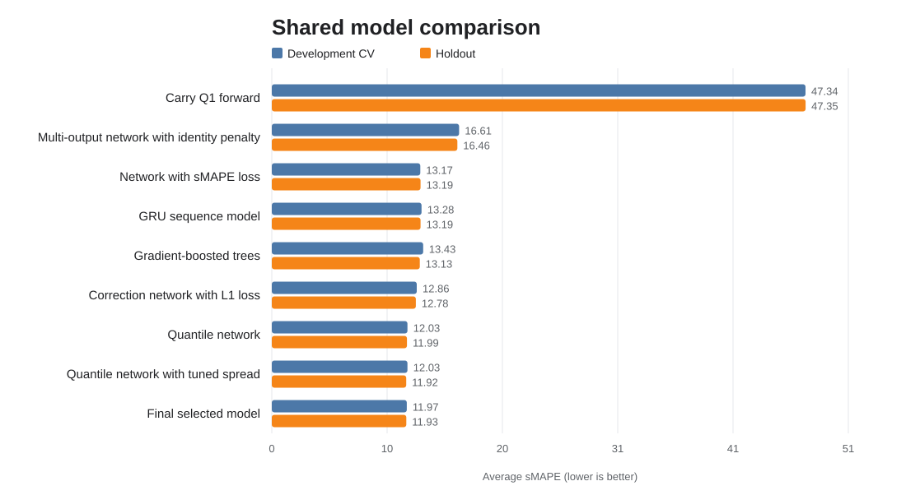
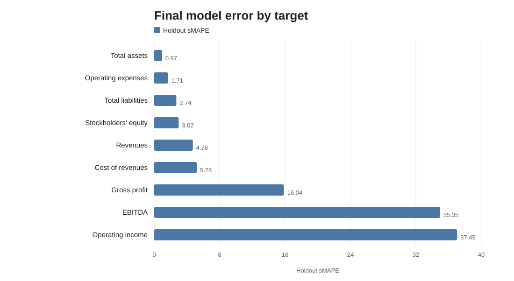

# Forecasting Quarterly Financial Statements

This project predicts nine current-quarter financial statement values from ten quarters of company history and current company metadata. It began as an individual model-comparison exercise and concluded with a group model that combined quantile neural networks, an sMAPE-aware decision rule, and accounting structure.

## Result

The final group model achieved **11.93 holdout sMAPE**, compared with **135.84** for the naive mean baseline—a **91.2% reduction**. Model selection used five-fold out-of-fold predictions on a 120,000-row development set; a separate 30,027-row holdout was used for the final comparison.

| Approach | Development CV sMAPE | Holdout sMAPE |
|---|---:|---:|
| Naive mean | 135.72 | 135.84 |
| Gradient-boosted trees | 13.43 | 13.13 |
| L1 correction network | 12.86 | 12.78 |
| Quantile network | 12.03 | 11.99 |
| **Final selected model** | **11.97** | **11.93** |



## Modeling progression

### Individual phase

The individual analysis compared a mean baseline, Elastic Net, Random Forest, XGBoost, multilayer perceptrons, and a hybrid GRU-MLP using the same five cross-validation folds. Signed-log targets stabilized the wide financial scales while preserving negative values. The strongest individual submission blended 93% accounting-adjusted XGBoost with 7% accounting-adjusted Random Forest and reached **13.9664 ± 0.1020 CV sMAPE**.

### Group phase

The group analysis retrained on 150,000 labeled observations and evaluated six shared model families. The selected network predicted 25 conditional quantiles for each target's scaled change from the previous quarter. A row-level decision layer selected the point minimizing expected sMAPE, and per-target spread calibration corrected overly narrow predictive distributions. Stockholders' equity was reconstructed from predicted assets and liabilities.

Operating income and EBITDA remained the hardest targets because they frequently change sign and are sensitive to small denominators under sMAPE.



## Repository layout

```text
data/          Dataset manifest and local setup instructions
docs/          Problem definition, project requirements, and data dictionary
notebooks/     Curated individual and final group analyses
reports/       Final individual and group reports
results/       Model-comparison tables and retained individual predictions
scripts/       Dataset verification/download and figure generation
src/           Reusable metric, data, and accounting helpers
tests/         Lightweight correctness tests
```

## Data

The synthetic dataset consists of four CSV files totaling approximately 864 MB. They are intentionally excluded from Git history because every file exceeds GitHub's recommended regular-Git file size and three exceed its 100 MiB hard limit.

After the files are uploaded to a GitHub Release tagged `data-v1`, download them with:

```bash
python scripts/download_data.py \
  --base-url https://github.com/OWNER/REPOSITORY/releases/download/data-v1
python scripts/verify_data.py
```

See [data/README.md](data/README.md) for the release-upload workflow and verified checksums.

## Environment

Python 3.12 was used for the final group run. Create an environment and install the project with:

```bash
python -m venv .venv
.venv/Scripts/activate              # Windows PowerShell: .venv\Scripts\Activate.ps1
python -m pip install --upgrade pip
python -m pip install -e .
python -m unittest discover -s tests
```

Open the notebooks from the repository root:

```bash
jupyter lab
```

The group notebook includes a `QUICK` switch for a reduced smoke run. A full run took about 102 minutes on a GPU-enabled environment.

## Reports

- [Individual prediction report](reports/individual_prediction_report.pdf)
- [Final group report](reports/final_group_report.pdf)

## Limitations

- The data are synthetic and include stable generator-specific scaling patterns that should not be interpreted as real-market behavior.
- Operating income and EBITDA frequently change sign, making percentage-based error especially difficult.
- The final holdout was examined across multiple pipeline versions, so its score may be mildly optimistic.
- The full workflow is computationally expensive and was evaluated with a focused rather than exhaustive hyperparameter search.

## Contributors

The final report was prepared by Sanketh, Sergio, Nigel, and Jacob. The individual notebook and individual report document Nigel's contribution; the group notebook and group report represent collaborative work.

